  
  
  
  
  
  
  

 

<a href="https://raw.githubusercontent.com/gowtham-dd/gowtham-dd/output/calendar-3d-full.svg">
<picture>
  <source media="(prefers-color-scheme: dark)" srcset="https://raw.githubusercontent.com/gowtham-dd/gowtham-dd/output/calendar-3d-dark.svg" />
  <source media="(prefers-color-scheme: light)" srcset="https://raw.githubusercontent.com/gowtham-dd/gowtham-dd/output/calendar-3d-light.svg" />
  
</picture>
</a>

Hover any card for its details · click to open it full-screen and explore.

 

<a href="https://raw.githubusercontent.com/gowtham-dd/gowtham-dd/output/about-full.svg">
<picture>
  <source media="(prefers-color-scheme: dark)" srcset="https://raw.githubusercontent.com/gowtham-dd/gowtham-dd/output/about-dark.svg" />
  <source media="(prefers-color-scheme: light)" srcset="https://raw.githubusercontent.com/gowtham-dd/gowtham-dd/output/about-light.svg" />
  
</picture>
</a>

 

<a href="https://raw.githubusercontent.com/gowtham-dd/gowtham-dd/output/hackathons-full.svg">
<picture>
  <source media="(prefers-color-scheme: dark)" srcset="https://raw.githubusercontent.com/gowtham-dd/gowtham-dd/output/hackathons-dark.svg" />
  <source media="(prefers-color-scheme: light)" srcset="https://raw.githubusercontent.com/gowtham-dd/gowtham-dd/output/hackathons-light.svg" />
  
</picture>
</a>

 

<a href="https://raw.githubusercontent.com/gowtham-dd/gowtham-dd/output/work-full.svg">
<picture>
  <source media="(prefers-color-scheme: dark)" srcset="https://raw.githubusercontent.com/gowtham-dd/gowtham-dd/output/work-dark.svg" />
  <source media="(prefers-color-scheme: light)" srcset="https://raw.githubusercontent.com/gowtham-dd/gowtham-dd/output/work-light.svg" />
  
</picture>
</a>

<a href="https://github.com/gowtham-dd/FHIRFlow">FHIRFlow</a> · <a href="https://github.com/gowtham-dd/PR-Reviewer-Agent">PR Reviewer Agent</a> · <a href="https://github.com/gowtham-dd/NeoVerse">NeoVerse / NEXUS AI</a> · <a href="https://github.com/gowtham-dd/NVDNLP">CVEE / NVDNLP</a> · <a href="https://github.com/gowtham-dd/PatholeDetection">MLOps Pothole Detection</a>

 

<a href="https://raw.githubusercontent.com/gowtham-dd/gowtham-dd/output/experience-full.svg">
<picture>
  <source media="(prefers-color-scheme: dark)" srcset="https://raw.githubusercontent.com/gowtham-dd/gowtham-dd/output/experience-dark.svg" />
  <source media="(prefers-color-scheme: light)" srcset="https://raw.githubusercontent.com/gowtham-dd/gowtham-dd/output/experience-light.svg" />
  
</picture>
</a>

 

<a href="https://raw.githubusercontent.com/gowtham-dd/gowtham-dd/output/stack-full.svg">
<picture>
  <source media="(prefers-color-scheme: dark)" srcset="https://raw.githubusercontent.com/gowtham-dd/gowtham-dd/output/stack-dark.svg" />
  <source media="(prefers-color-scheme: light)" srcset="https://raw.githubusercontent.com/gowtham-dd/gowtham-dd/output/stack-light.svg" />
  
</picture>
</a>

 

<a href="https://raw.githubusercontent.com/gowtham-dd/gowtham-dd/output/languages-full.svg">
<picture>
  <source media="(prefers-color-scheme: dark)" srcset="https://raw.githubusercontent.com/gowtham-dd/gowtham-dd/output/languages-dark.svg" />
  <source media="(prefers-color-scheme: light)" srcset="https://raw.githubusercontent.com/gowtham-dd/gowtham-dd/output/languages-light.svg" />
  
</picture>
</a>

 

<picture>
  <source media="(prefers-color-scheme: dark)" srcset="https://raw.githubusercontent.com/gowtham-dd/gowtham-dd/output/snake-dark.svg" />
  <source media="(prefers-color-scheme: light)" srcset="https://raw.githubusercontent.com/gowtham-dd/gowtham-dd/output/snake.svg" />
  
</picture>

Every graphic here is generated by <a href="./scripts"><code>scripts/</code></a> from <a href="./data/profile.json"><code>data/profile.json</code></a> and live GitHub data, refreshed every 12 hours.

