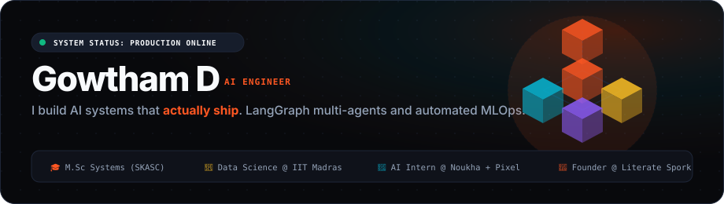
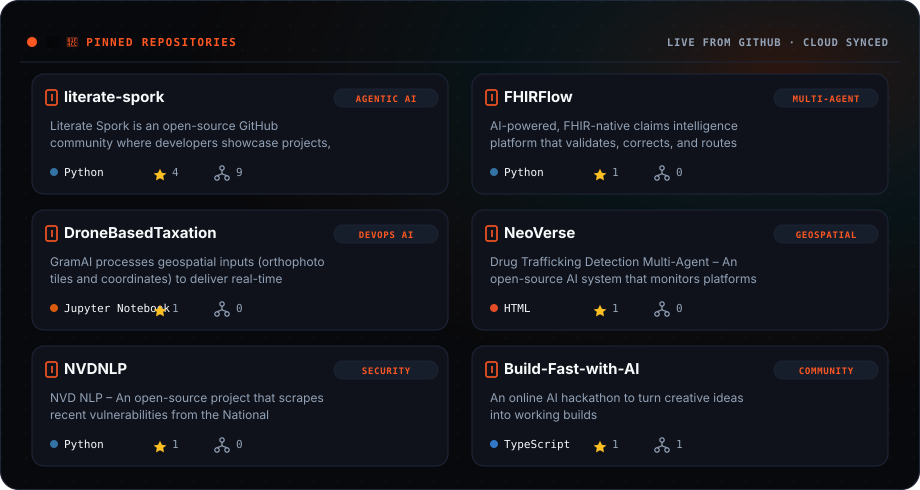
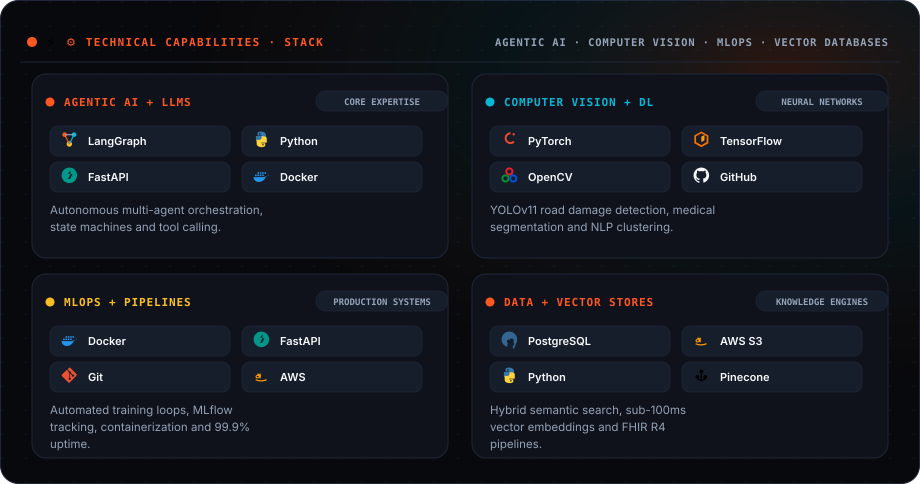
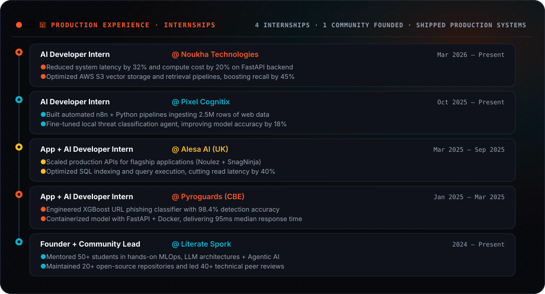
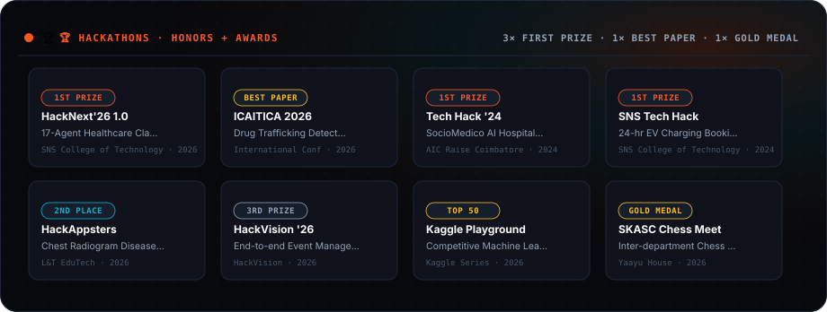
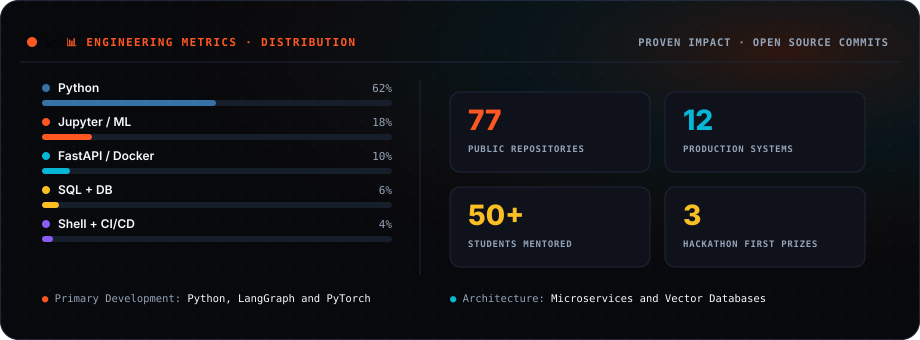

<!-- ═══════════════════════════════════════════════════════════════════════
     GOWTHAM D — AUTONOMOUS AI ENGINEER & MLOPS PORTFOLIO
     Palette: Obsidian (#08090C) · Solar Flame (#FF5722) · Amber (#FBBF24)
     ═══════════════════════════════════════════════════════════════════════ -->

<picture>
  <source media="(prefers-color-scheme: dark)" srcset="https://raw.githubusercontent.com/gowtham-dd/gowtham-dd/output/hero-banner-dark.svg" />
  <source media="(prefers-color-scheme: light)" srcset="https://raw.githubusercontent.com/gowtham-dd/gowtham-dd/output/hero-banner-light.svg" />
  
</picture>

  &nbsp;&nbsp;&nbsp;&nbsp;
  &nbsp;&nbsp;&nbsp;&nbsp;
  &nbsp;&nbsp;&nbsp;&nbsp;
  &nbsp;&nbsp;&nbsp;&nbsp;
  &nbsp;&nbsp;&nbsp;&nbsp;
  

 

<picture>
  <source media="(prefers-color-scheme: dark)" srcset="https://raw.githubusercontent.com/gowtham-dd/gowtham-dd/output/pinned-projects-dark.svg" />
  <source media="(prefers-color-scheme: light)" srcset="https://raw.githubusercontent.com/gowtham-dd/gowtham-dd/output/pinned-projects-light.svg" />
  
</picture>

 

<picture>
  <source media="(prefers-color-scheme: dark)" srcset="https://raw.githubusercontent.com/gowtham-dd/gowtham-dd/output/skills-bento-dark.svg" />
  <source media="(prefers-color-scheme: light)" srcset="https://raw.githubusercontent.com/gowtham-dd/gowtham-dd/output/skills-bento-light.svg" />
  
</picture>

 

<picture>
  <source media="(prefers-color-scheme: dark)" srcset="https://raw.githubusercontent.com/gowtham-dd/gowtham-dd/output/experience-timeline-dark.svg" />
  <source media="(prefers-color-scheme: light)" srcset="https://raw.githubusercontent.com/gowtham-dd/gowtham-dd/output/experience-timeline-light.svg" />
  
</picture>

 

<picture>
  <source media="(prefers-color-scheme: dark)" srcset="https://raw.githubusercontent.com/gowtham-dd/gowtham-dd/output/hackathons-grid-dark.svg" />
  <source media="(prefers-color-scheme: light)" srcset="https://raw.githubusercontent.com/gowtham-dd/gowtham-dd/output/hackathons-grid-light.svg" />
  
</picture>

 

<picture>
  <source media="(prefers-color-scheme: dark)" srcset="https://raw.githubusercontent.com/gowtham-dd/gowtham-dd/output/activity-radar-dark.svg" />
  <source media="(prefers-color-scheme: light)" srcset="https://raw.githubusercontent.com/gowtham-dd/gowtham-dd/output/activity-radar-light.svg" />
  
</picture>

 

<picture>
  <source media="(prefers-color-scheme: dark)" srcset="https://raw.githubusercontent.com/gowtham-dd/gowtham-dd/output/snake-dark.svg" />
  <source media="(prefers-color-scheme: light)" srcset="https://raw.githubusercontent.com/gowtham-dd/gowtham-dd/output/snake.svg" />
  
</picture>

  Automated profile intelligence · Synchronized with live production source code

